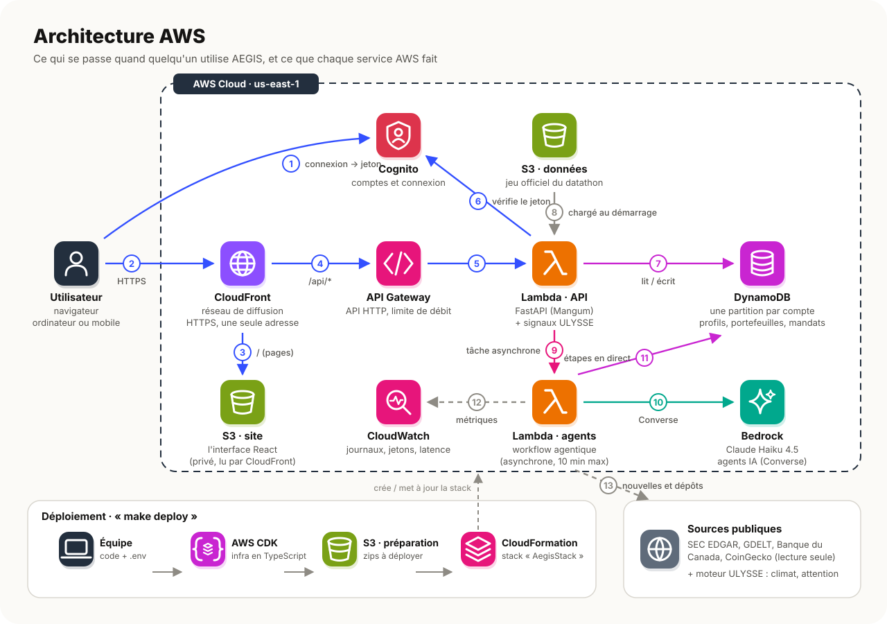
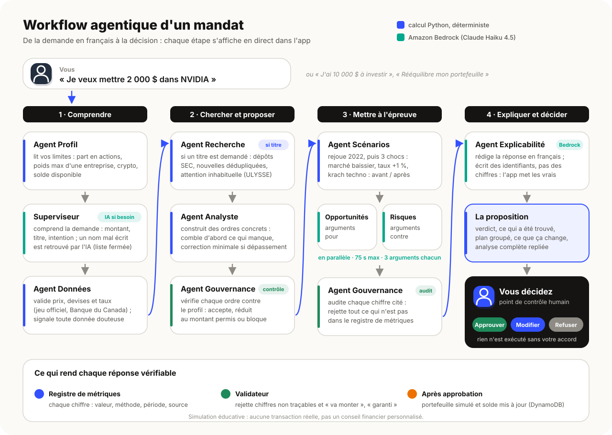

# AEGIS — investir, avec un accompagnement qui *vous* ressemble

> Datathon PolyFinances 2026 · défi **AlphaForge AI** (Banque Nationale × AWS)
> Une solution **agentique et auto-explicative** : vous dites en français ce que vous voulez faire de votre argent, des agents
> analysent votre profil, vos placements et le marché, vérifient chaque chiffre et vous proposent quoi faire. Vous décidez.

**Essayer en ligne : https://d2p220whqnshao.cloudfront.net** — trois comptes de démonstration sont prêts (voir plus bas).

*Simulation éducative : aucune transaction réelle, pas un conseil financier personnalisé.*

---

## Sommaire

1. [La problématique](#1-la-problématique)
2. [Le contexte](#2-le-contexte)
3. [Notre solution](#3-notre-solution)
4. [Architecture AWS](#4-architecture-aws)
5. [Le workflow agentique](#5-le-workflow-agentique)
6. [Lancer l'application](#6-lancer-lapplication)
7. [Comptes de démonstration](#7-comptes-de-démonstration)
8. [Déployer sur AWS](#8-déployer-sur-aws)
9. [Tests](#9-tests)
10. [Organisation du code](#10-organisation-du-code)
11. [Limites et responsabilité](#11-limites-et-responsabilité)

---

## 1. La problématique

Les investisseurs n'ont jamais eu autant d'informations : cours, publications d'entreprises, taux, nouvelles, réseaux sociaux.
Leur difficulté n'est plus d'y accéder, mais de **les trier, les relier et en tirer une décision qui leur convient vraiment**.

En pratique, trois choses tournent mal :

- **Le portefeuille ne ressemble pas à la personne.** Quelqu'un de prudent finit avec 90 % d'actions technologiques parce que
  ce sont les titres dont tout le monde parle.
- **L'engouement décide à la place de la personne.** Un titre « viral » pousse à acheter sous le coup de l'émotion, sans
  regarder le risque ni la place qu'il prendrait dans le portefeuille.
- **Les outils d'IA inventent ou n'expliquent pas.** Une réponse convaincante mais impossible à vérifier est dangereuse quand il
  s'agit d'argent : d'où vient ce chiffre ? Sur quelle période ? Qu'est-ce qui pourrait mal tourner ?

Et pour celles et ceux qui débutent, la première question est souvent plus simple : *par où commencer ?*

## 2. Le contexte

Le défi AlphaForge AI demande de **concevoir une solution agentique auto-explicative qui exploite des données financières
publiques pour éclairer la décision d'investissement selon différents profils**, en expliquant ses sources, ses hypothèses et
ses limites. L'objectif n'est pas de trouver le portefeuille le plus rentable, mais une démarche **crédible, utile et responsable**.

Trois investisseurs fictifs servent de cas de référence :

| Persona | Profil | Ce que le cas teste |
|---|---|---|
| **Amira**, 26 ans | risque élevé, horizon 15 ans+, attirée par l'IA et la crypto | jusqu'où accepter le risque, sans que « élevé » veuille dire « tout est permis » |
| **Mateo**, 41 ans | modéré, deux enfants, préférences ESG | équilibre croissance / stabilité et respect de ses valeurs |
| **Robert**, 59 ans | faible à modéré, horizon 3 à 5 ans, attiré par les titres populaires | la cohérence entre ce qu'il demande et ce que son profil permet |

Données : le jeu officiel du datathon (31 actifs, prix quotidiens de novembre 2021 à novembre 2026, taux de change de la
Banque du Canada, taux et données macro), complété par des sources publiques (SEC EDGAR, GDELT, CoinGecko, Wikipédia).

## 3. Notre solution

AEGIS fonctionne comme une application bancaire, avec une différence : **chaque décision passe par une équipe d'agents qui
analyse, se contredit, se fait auditer et s'explique**, avant que vous ne disiez oui ou non.

| Étape | Ce que vit l'utilisateur |
|---|---|
| **Créer un compte** | Inscription sécurisée (Amazon Cognito). Chaque compte reçoit de l'argent fictif pour apprendre sans risque. |
| **Faire connaissance** | Un questionnaire « Connaître son client » d'une vingtaine de questions : situation, budget, connaissances, rapport au risque. Trois mesures (ce que vous êtes prêt à risquer, ce que votre situation permet, ce que vous connaissez) ; **la plus basse fixe le profil**, et chaque raison est affichée. |
| **Connecter ses placements** | Connexion simulée à un compte de courtage (placements fictifs achetés aux vrais prix historiques) ou saisie manuelle. Les agents disent tout de suite, en clair, si le portefeuille respecte le profil. |
| **Demander** | En français libre : « J'ai 10 000 $ à investir », « Je veux 2 000 $ de NVIDIA », « Rééquilibre mon portefeuille ». |
| **Voir les agents travailler** | Chaque étape s'affiche en direct, puis une proposition visuelle : verdict, ce qui a été trouvé, plan d'ordres groupé, ce que ça change, analyse complète repliée. |
| **Décider** | Approuver (le portefeuille simulé et le solde sont mis à jour), Modifier ou Refuser. Rien n'est exécuté sans accord. |
| **Apprendre** | Visite guidée au premier passage, « Comment ça marche ? » sur chaque écran, sept leçons de 2 minutes (risque, diversification, intérêts composés avec calculateur, émotions et frais…). Léa, l'assistante, répond aux questions à tout moment. |

Ce qui rend les réponses **dignes de confiance** :

- **Les chiffres ne viennent jamais de l'IA.** Ils sont calculés en Python et enregistrés dans un *registre de métriques*
  (valeur, méthode, période, source). L'IA écrit des identifiants ; l'interface affiche les vraies valeurs, cliquables.
- **Un validateur** rejette tout chiffre non traçable et toute promesse (« va monter », « garanti »).
- **Des agents adverses** (Opportunités contre Risques) argumentent, puis la Gouvernance audite chaque affirmation.
- **Des signaux de marché qui décrivent sans prédire** (moteur ULYSSE) : climat de marché (calme, agité ou tendu) et attention
  inhabituelle sur un titre, pour décider à froid.
- **Le contrôle humain** reste au centre : l'application propose, la personne décide.

## 4. Architecture AWS



| Service | Rôle dans AEGIS |
|---|---|
| **Amazon CloudFront** | Point d'entrée unique en HTTPS : sert l'interface et redirige `/api/*` vers l'API (même adresse, pas de CORS). |
| **Amazon S3** | Trois buckets privés : l'interface React compilée, le jeu de données officiel, et la zone de préparation du déploiement. |
| **Amazon Cognito** | Comptes et connexion. Le navigateur parle directement à Cognito ; le mot de passe ne passe jamais par nos serveurs. |
| **Amazon API Gateway** | API HTTP devant la Lambda, avec limitation du débit. |
| **AWS Lambda · API** | L'API FastAPI (via Mangum) : profil, placements, mandats, solde. Elle fait valider chaque jeton par Cognito. |
| **AWS Lambda · agents** | Le workflow agentique, lancé en asynchrone (jusqu'à 10 minutes) pour ne jamais bloquer l'interface. |
| **Amazon DynamoDB** | Toutes les données des utilisateurs, une partition par compte (`PK = USER#<compte>`) : personne ne lit les données d'un autre. |
| **Amazon Bedrock** | Claude Haiku 4.5 (API Converse) pour les agents qui raisonnent et rédigent. Permission limitée à ce seul modèle. |
| **Amazon CloudWatch** | Journaux, et pour chaque agent : jetons consommés et latence, dans un tableau de bord. |
| **AWS CDK → CloudFormation** | Toute l'infrastructure est décrite en TypeScript (`infrastructure/`) et déployée en une commande. |

Le moteur statistique ULYSSE (climat de marché, attention inhabituelle) tourne en direct en local ; pour AWS, ses signaux sont
précalculés au moment du build et embarqués dans la Lambda, ce qui évite d'y ajouter scikit-learn et SciPy.

## 5. Le workflow agentique



| # | Agent | Ce qu'il fait | Outil |
|---|---|---|---|
| 1 | **Profil** | lit les limites du profil et le solde disponible | Python |
| 2 | **Superviseur** | comprend la demande (montant, titre, intention) ; retrouve un nom mal écrit dans la liste fermée des actifs | Python + Bedrock si besoin |
| 3 | **Données** | valide prix, devises et taux ; signale toute donnée douteuse | Python |
| 4 | **Recherche** | si un titre est demandé : dépôts SEC, nouvelles dédupliquées, attention inhabituelle (ULYSSE) | sources publiques |
| 5 | **Analyste** | construit des ordres concrets : comble ce qui manque, ou corrige au minimum un dépassement | Python |
| 6 | **Gouvernance** | vérifie chaque ordre : l'accepte, le réduit au montant permis, ou le bloque | Python |
| 7 | **Scénarios** | rejoue 2022 et trois chocs hypothétiques, avant et après | Python |
| 8 | **Opportunités / Risques** | arguments pour et contre, en parallèle (délai borné) | Bedrock |
| 9 | **Gouvernance (audit)** | vérifie chaque chiffre cité contre le registre de métriques | Python |
| 10 | **Explicabilité** | rédige la réponse en français, avec des chiffres vérifiés | Bedrock |
| 11 | **Vous** | approuvez, modifiez ou refusez | humain |

Si Bedrock est lent ou indisponible, la proposition est quand même produite (les étapes déterministes suffisent) et l'interface
le dit clairement.

## 6. Lancer l'application

**Prérequis** : Python 3.12+, Node 20+.

```bash
git clone https://github.com/amine2125/finance-advsior.git && cd finance-advsior && git checkout fusion
make setup      # environnement Python (AEGIS + ULYSSE), dépendances de l'interface et de l'infrastructure
make data       # jeu de données officiel (data/active) + datapack ULYSSE (data/build), à partir du kit dans context/
make test       # tests backend, sans AWS ni réseau
make api        # API sur http://127.0.0.1:8000
make web        # interface sur http://localhost:5173 (dans un autre terminal)
```

**Configuration** : copiez `.env.example` en `.env`.

- Sans rien d'autre, l'application tourne en **mode bac à sable** : pas de connexion, données dans des fichiers locaux, IA désactivée.
- Avec des **clés AWS** (les lignes `export KEY=…` copiées d'un portail AWS sont acceptées), les agents utilisent Bedrock.
- En décommentant la section **« Comptes et base de données »** (valeurs données par `cdk deploy`), le serveur local utilise les
  mêmes comptes Cognito et la même table DynamoDB que la version en ligne.

Les clés temporaires d'un atelier AWS expirent après quelques heures : si les agents ne répondent plus, recollez-en de nouvelles
dans `.env` et relancez `make api`.

## 7. Comptes de démonstration

Sur la page de connexion, boutons **« Entrer »**, ou :

| Compte | Courriel | Mot de passe | Ce qu'on y voit |
|---|---|---|---|
| Amira | `amira@demo.aegis-finance.ca` | `AegisDemo2026!` | profil élevé, trop concentrée en technologie et en NVIDIA |
| Mateo | `mateo@demo.aegis-finance.ca` | `AegisDemo2026!` | profil modéré, portefeuille conforme : « rien à changer », avec des idées |
| Robert | `robert@demo.aegis-finance.ca` | `AegisDemo2026!` | profil faible à modéré, trop d'actions populaires : rééquilibrage proposé |

Ce sont des comptes ordinaires (mêmes écrans, mêmes agents, réponses modifiables). Leurs données sont recréées à la première
connexion et après « Tout effacer et recommencer » (page Profil). On peut aussi créer son propre compte : il est actif tout de suite.

Idées à essayer : avec Robert, « Je veux 3 000 $ de Tesla » (refusé, avec une alternative) ; avec Amira, « Rééquilibre mon
portefeuille » ; avec Mateo, « J'ai 5 000 $ à investir ».

## 8. Déployer sur AWS

```bash
make deploy
```

Cette commande :

1. construit le paquet Lambda sans Docker (bibliothèques Linux + code + signaux ULYSSE précalculés) ;
2. compile l'interface ;
3. lance `cdk deploy` : CDK génère un modèle CloudFormation, dépose les paquets dans S3, puis CloudFormation crée ou met à
   jour la stack `AegisStack` (et annule tout en cas d'échec) ;
4. crée ou réinitialise les trois comptes de démonstration dans Cognito.

Les clés AWS sont lues dans `.env`. L'adresse du site est affichée à la fin (`AppUrl`).

## 9. Tests

```bash
make test       # 88 tests : formules financières, profils, verdicts, mandats, solde, signaux ULYSSE, API, gouvernance
make e2e        # parcours complet dans un navigateur (make api + make web lancés) : inscription, questionnaire, visite guidée,
                # deux demandes aux agents, approbation, leçon, déconnexion
```

## 10. Organisation du code

```
frontend/                interface React + Vite + Tailwind + Framer Motion
backend/app/             API FastAPI (/api/v1) : comptes, profil, placements, mandats, agents, gouvernance, solde
backend/ulysse/          moteur ULYSSE : datapack « à date », climat de marché, attention inhabituelle, mesures avancées
backend/tests_aegis/     tests de l'API et des agents
backend/tests/           tests du moteur ULYSSE
infrastructure/          AWS CDK (TypeScript) : la stack complète
scripts/                 import du jeu de données, build Lambda, comptes de démonstration
docs/                    les deux diagrammes de ce document
context/Datathon2026/    énoncé et kit de départ officiels
```

## 11. Limites et responsabilité

- **Simulation** : l'argent est fictif, aucune transaction n'est exécutée, aucune vraie banque n'est contactée.
- **Pas un conseil personnalisé** : AEGIS vérifie la cohérence entre une idée et le profil déclaré ; il ne remplace pas un
  conseiller.
- **Le passé ne prédit pas l'avenir** : rejeux et scénarios décrivent ce qui s'est passé ou une hypothèse explicite.
- **Données datées** : le jeu officiel s'arrête en novembre 2026 ; une donnée manquante est signalée, jamais inventée.
- **Comptes de démonstration partagés** : leurs identifiants sont publics par conception, pour le jury.
